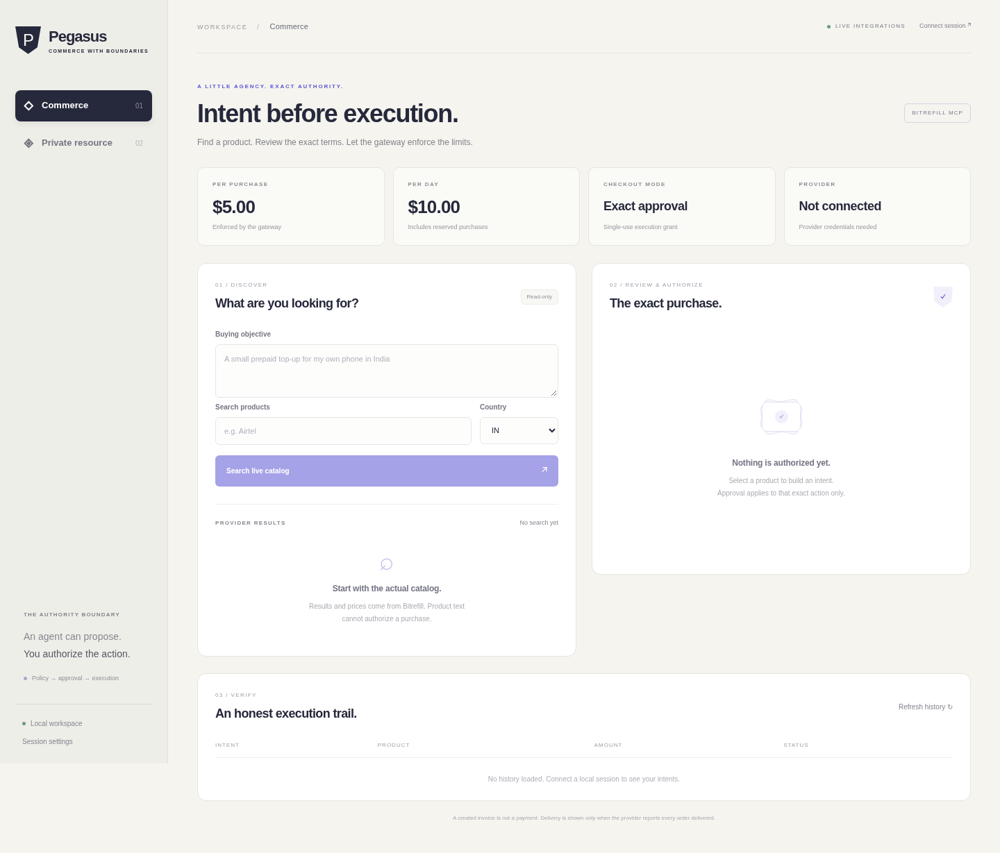
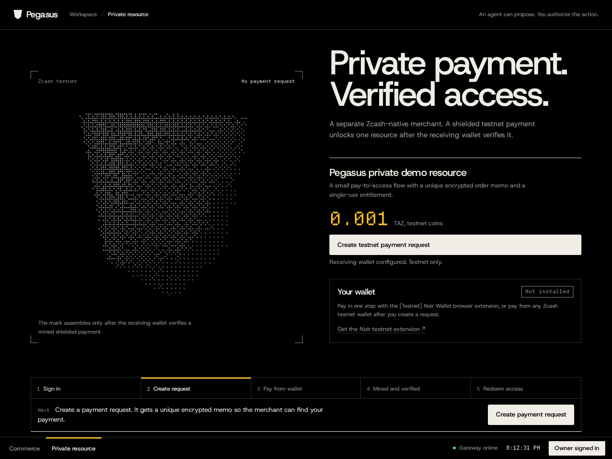
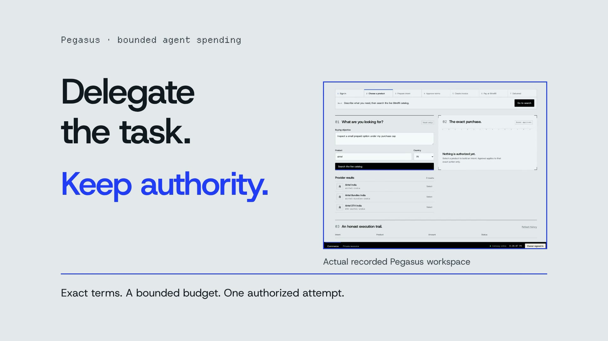
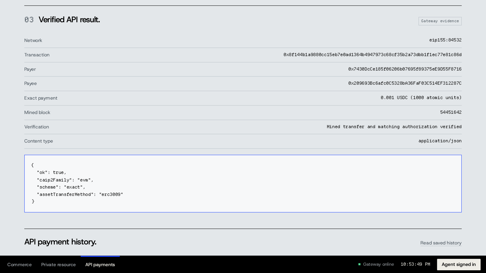
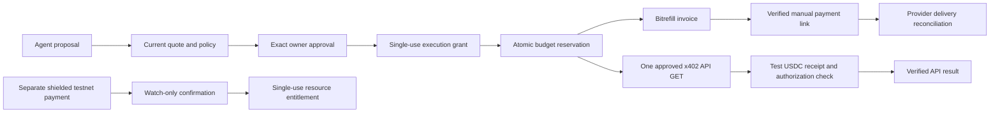

<a id="readme-top"></a>

<div align="center">

<picture>
  <source media="(prefers-color-scheme: dark)" srcset="docs/assets/logo-on-dark.svg" />
  
</picture>

# Pegasus

**Policy-bound shopping for people who want an agent to prepare purchases while keeping exact approval and spending authority outside the model.**

[](pyproject.toml)
[](docs/architecture.md)
[](#limitations)

[Quick start](#quick-start) · [Usage](#usage) · [Documentation](#documentation) · [Contributing](#contributing)

</div>

<br/>

<p align="center">
  
</p>

<p align="center">
  
</p>

<p align="center"><sub>Captured from the running dashboard. <a href="docs/assets/demo-mobile.png">Mobile view</a>.</sub></p>

> [!NOTE]
> **Prototype v0.1.0.** Real shielded Zcash payments and an owner-approved x402 API payment have been verified on public testnets. A credential-backed Bitrefill purchase-and-delivery run is still pending; invoice creation alone is not delivery.

## Overview

Pegasus is a local commerce gateway for people and small teams using an external shopping agent. It keeps purchase policy, exact owner approval, and execution authority in deterministic code, with a separate Zcash testnet merchant for private resource access.

**Implemented:** live Bitrefill MCP adapter, separate owner approval, signed single-use execution grants, USD spend caps, encrypted SQLite records, an agent-facing MCP interface, an independent Zcash testnet resource checkout, and an opt-in x402 guard for external API payments on Base Sepolia. The dashboard runs locally with no frontend build step.

### Features

- **Bounded spending.** Default ceilings are $5 per purchase and $10 per India calendar day, with the approved maximum reserved before checkout.
- **Exact owner approval.** A SHA-256 intent digest binds the product, denomination, recipient, method, currency, and ceiling to a 90-second grant.
- **One purchase attempt.** Atomic grant consumption rejects replay; an ambiguous provider result remains `UNCERTAIN` with its reservation retained.
- **Provider-backed delivery status.** Current catalog prices and invoice terms are checked; delivery is reported only when every order is delivered.
- **Independent shielded checkout.** A watch-only receiver verifies mined testnet notes and the order memo before issuing a five-minute, single-use resource entitlement.
- **Guarded API payments.** Review one allowlisted x402 v2 `exact` GET request, approve its full payment terms, and attempt it once with test USDC. API payments and Bitrefill share the same USD reservation ledger.
- **Clear authority boundaries.** Domain rules, application use cases, external adapters, and HTTP/MCP interfaces occupy separate layers.
- **Guided workspace.** Role-aware sign-in, a visible next step, automatic payment-status checks, and restored intent/order progress after a reload.

## Why Pegasus

An agent can select an item within a budget and still change the recipient, reuse an old approval, or act on a stale price. A conversational confirmation does not bind the later checkout arguments.

```text
Owner approves: exact SKU + denomination + recipient + method + spend ceiling
Agent changes a term or replays the grant → gateway denies the purchase
```

Pegasus handles this with a canonical action, deterministic policy, a short-lived signed grant, and an atomic execution gateway. Product descriptions and model output do not authorize a purchase.

> **The agent prepares a purchase; deterministic code and exact owner approval authorize it.**

## Requirements

| Requirement | Details |
| :--- | :--- |
| **OS** | The local demo was verified on Linux x86_64. Other operating systems have not been verified. |
| **Runtime** | Python 3.11+ and `uv`; a browser for the dashboard. |
| **Commerce** | A backend Bitrefill developer key and explicit product, receipt-email, and recipient allowlists. |
| **Optional** | Node.js for Bitrefill CLI diagnostics and browser checks. |
| **Optional private checkout** | A loopback `zkool_graphql` testnet receiver. The documented prebuilt wallet binary is Linux x86_64; other platforms may require a source build. |
| **Optional API payments** | The `x402` extra, an allowlisted Base Sepolia API/payee, and a dedicated local testnet payer key. See [x402 payments](docs/x402-payments.md). Disabled by default. |

Requires Python 3.11+ and [uv](https://docs.astral.sh/uv/). Node is only needed for optional Bitrefill CLI diagnostics and browser checks.

## Installation

```bash
git clone https://github.com/Dijo-404/pegasus.git
cd pegasus
uv sync --locked
```

This installs the package and development dependencies from the committed lockfile into the project virtual environment. Wallet setup is separate; see [the Zcash testnet guide](docs/zcash-testnet.md).

For optional external API payments, install `uv sync --locked --extra x402` and follow [the x402 setup guide](docs/x402-payments.md). Installing the extra does not create a wallet, enable payments, or send funds.

### Updating

Stop the local server before updating, then restart it with the quick-start command.

```bash
git pull --ff-only
uv sync --locked
```

The setup script preserves an existing `.env`.

## Quick start

```bash
uv sync --locked  # Install the locked project dependencies
uv run python scripts/setup_environment.py  # Create private local credentials without overwriting .env
uv run uvicorn pegasus.bootstrap:create_app --factory --host 127.0.0.1 --port 8787  # Start the dashboard and trusted gateway on loopback
```

Open <http://127.0.0.1:8787>. Open the private `.env` locally and use **Sign in** to paste **OWNER_TOKEN**; the gateway confirms whether it is the owner or agent token. Bootstrap creates random credentials with mode 0600, does not print them, and never overwrites an existing `.env`.

### Public testnet demo

Open <https://notified-accountability-requirement-taste.trycloudflare.com>. Protected actions require the existing private owner/agent credential, entered through **Sign in**. This temporary HTTPS tunnel depends on the operator's machine and wallet processes remaining online; its hostname changes when a new tunnel is created. [Deployment and verification guide](docs/deployment.md) includes service controls and the explicit live-test command.

### Pitch and demo video

[](docs/assets/pegasus-pitch-demo.mp4)

[**Watch or download the verified pitch (v4)**](docs/assets/pegasus-pitch-demo.mp4) · **2:00** · **1920 × 1080 · 30 fps** · **16.7 MiB**

The approved v4 HyperFrames pitch is **exported and verified**: eight scenes, 3,600 frames, pitch-preserved **1.10×** media playback, full audio/video decode passed. Encoded audio measures **−14.30 LUFS** integrated and **−1.92 dBTP** true peak. [v4 export receipt](docs/evidence/demo-video-export-v4.json) · [Production and evidence notes](docs/demo-video.md).

The pitch brings [verified x402 proof](docs/evidence/x402-testnet-payment.json) forward to **0:12**. A blue approval frame carries exact permission into the shared budget and real results, with masked headlines, matched product-frame moves and reading holds. It reviews the earlier HTTP payment and recorded manual Zcash checkout; no new payment is staged. Bitrefill delivery remains pending. [Actual narration](docs/demo-narration.md) uses the new opening/closing and reordered existing speech. The optional [local editable preview](http://localhost:3004/#project/pegasus-film) works while its server runs. The superseded v3 preview was never exported; the [v2 receipt](docs/evidence/demo-video-export.json) remains historical evidence.

## Usage

### Commands

| Command | Description |
| :--- | :--- |
| `uv run python scripts/setup_environment.py` | Create random local owner, agent, signing, and encryption credentials; preserve existing configuration. |
| `uv run uvicorn pegasus.bootstrap:create_app --factory --host 127.0.0.1 --port 8787` | Start the dashboard and trusted HTTP gateway. |
| `uv run python -m pegasus.presentation.mcp.server` | Start the agent-facing stdio MCP server with `AGENT_TOKEN` supplied separately. |
| `uv run python scripts/zcash_testnet.py --help` | Show the explicit testnet wallet setup, faucet, send, and watch commands. |
| `uv run --extra x402 python scripts/setup_x402_wallet.py` | Explicitly create a dedicated testnet payer key beneath ignored `.local/`; print public metadata only. Optional, and refuses to overwrite an existing key. |
| `uv run python scripts/verify_testnet_deployment.py --base-url <public-https-origin>` | Explicitly send one capped testnet payment and verify the deployed private checkout; resume using the same state file. |
| `uv run pytest -q` | Run unit, integration, security, and architecture checks. |

### Dashboard flow

Use **Sign in** to enter an owner or agent token; the gateway identifies its role. **Commerce** guides product selection, exact approval, invoice creation, payment and delivery. **Private resource** guides a separate Zcash testnet payment and single-use access. **API payments** guides an unsigned x402 challenge, exact owner approval and one explicitly requested testnet payment attempt. Each tab highlights the current step and offers its next action.

Pending Bitrefill invoices refresh every 30 seconds; private payments refresh every 20 seconds, with a visible countdown. Checks pause while the tab is hidden and stop after a bounded window. Reloading restores the current intent and private order from their saved IDs; execution grants stay in page memory and are not recreated. Signing out clears tokens and sensitive purchase/payment details from the view.

### Examples

**Review one purchase.** Configure the local allowlists, search the catalog, choose an exact denomination, and review every term, including the receipt destination. An API key uses its connected Bitrefill account; guest checkout uses an allowlisted email. Approve as owner, execute the grant once, and refresh the authoritative invoice state. Open a provider payment link only after the gateway verifies its terms.

**Pay for the separate private resource.** Create a testnet payment request, send the requested amount and memo from a compatible wallet, refresh until the receiving watcher confirms it, and redeem the entitlement once. See [the demo guide](docs/demo-guide.md) for the walkthrough.

**Guard one external API payment.** After the operator enables the optional integration, open **API payments**, enter an allowlisted HTTPS GET URL and a ceiling in whole USD cents, then choose **Read unpaid challenge**. Review the resource, payee, token, network, amount, ceiling and fingerprint. An owner approves those exact terms, then chooses **Pay once and call API**. A verified mined USDC receipt is required before the result is shown. `UNCERTAIN` means reconcile manually; reading saved status never repeats the payment. See [x402 payments](docs/x402-payments.md).

### Connect an agent

The application supports an external MCP-capable coding or shopping agent. There is no embedded LLM, paid model dependency, or simulated autonomous purchase. This is the small trusted authority boundary around an agent.

Start `pegasus.presentation.mcp.server` in a separate process with **only AGENT_TOKEN**, while the trusted HTTP gateway runs on loopback port 8787. The MCP process deliberately does not load `.env`.

```json
{
  "mcpServers": {
    "pegasus": {
      "command": "/absolute/path/to/pegasus/.venv/bin/python",
      "args": ["-m", "pegasus.presentation.mcp.server"],
      "env": {"AGENT_TOKEN": "<copy only the local AGENT_TOKEN>"}
    }
  }
}
```

Commerce tools: `search_products`, `product_details`, `propose_purchase`, `execute_approved_purchase`, `purchase_status`. Optional API-payment tools: `propose_api_payment`, `execute_approved_api_payment`, `api_payment_status`. Approval happens in the owner dashboard. The dashboard can execute the approved grant itself; an external agent can execute a grant explicitly supplied by the owner. The agent never gets the owner credential, Bitrefill key, EVM signing key, payment signature, invoice access token or guest payment link.

### Live payment evidence

Four real shielded payments were independently verified on **Zcash public testnet on 4 November 2026**, listed in mined order. These payments belong to the separate Zcash-native merchant; they do not settle Bitrefill purchases.

| Transaction hash | Amount | Pool | Mined height | Verified flow |
| :--- | :--- | :--- | ---: | :--- |
| [`d95a809359a47156c20d63eb560dabb99bdc3462d60f23e17689f73f7ffaefe5`](https://zexplorer.app/testnet/tx/d95a809359a47156c20d63eb560dabb99bdc3462d60f23e17689f73f7ffaefe5) | 0.001 TAZ | Ironwood | 4581917 | [Watch-only wallet verifier](docs/evidence/zcash-testnet.json). |
| [`ef7f9cf6132cbf4df41a5195e6ebbd4034b09efbd53828f35a276afa17485b10`](https://zexplorer.app/testnet/tx/ef7f9cf6132cbf4df41a5195e6ebbd4034b09efbd53828f35a276afa17485b10) | 0.001 TAZ | Ironwood | 4581925 | [Recovered API checkout](docs/evidence/private-merchant-e2e.json); resource redeemed once, replay rejected. |
| [`c1d1319c62a1cca8c61502e9e27be92a72168e962de8d92831a09cfb91d45c7a`](https://zexplorer.app/testnet/tx/c1d1319c62a1cca8c61502e9e27be92a72168e962de8d92831a09cfb91d45c7a) | 0.001 TAZ | Ironwood | 4582071 | [Fresh public HTTPS checkout](docs/evidence/deployed-testnet-checkout.json); redemption and replay checks survived [restart](docs/evidence/deployment-smoke.json). |
| [`5e0179d3ca9ea1be3835a0eadb92ade8244fb4e5f25f8c647c3e74aff0e47929`](https://zexplorer.app/testnet/tx/5e0179d3ca9ea1be3835a0eadb92ade8244fb4e5f25f8c647c3e74aff0e47929) | 0.001 TAZ | Ironwood | 4582394 | [Recorded live UI checkout](docs/evidence/recorded-demo-checkout.json); manual local payer, one redemption and HTTP 409 replay rejection. |

The recorded checkout used the running UI and a fresh payment with its API-created memo. Noir was not installed, so the operator sent from the disposable local payer through the loopback signing service; the same development operator controls both wallets. The independent watch-only receiver verified the mined note at one confirmation, access returned once, and replay returned HTTP 409. The approved video edit condenses and labels the **40.102-second mining wait**; it does not depict a Noir approval or a Bitrefill purchase.

The public HTTPS checkout completed uninterrupted at one confirmation: the API denied unpaid access, confirmed the exact order payment through its watch-only receiver, returned the protected resource once, and rejected replay with HTTP 409. Redeemed state and replay rejection survived an application restart.

The earlier recovered API checkout verified five confirmations. Its original order fields were restored after a temporary test process lost its ephemeral encryption key. No payment was resent during recovery, and that earlier run is not claimed as uninterrupted. The [original receipt](docs/evidence/private-merchant-e2e.json) preserves the interruption and recovery disclosure.

Public explorers verify transaction existence, height and fees; they do not reveal shielded amounts or memos. The amounts and exact memo checks above came from the receiver's authorized watch-only wallet.

### Verified x402 testnet API payment

<p align="center">
  <a href="docs/assets/demo-x402.png"></a>
</p>
<p align="center"><sub>Saved verified result · recorded after settlement</sub></p>

On **4 November 2026**, the gateway completed a real x402 v2 `exact` API request using **0.001 test USDC on Base Sepolia**, with a **one-cent approved ceiling**. The actual HTTP flow used owner approval followed by execution with the agent credential. The configured public RPC verified a mined status-1 receipt, the exact USDC `Transfer`, and `AuthorizationUsed` for the signed nonce. This is a transparent EVM payment, separate from the shielded Zcash receipts and pending Bitrefill delivery. [Live receipt](docs/evidence/x402-testnet-payment.json).

| Transaction | Mined block | Observed checks |
| :--- | ---: | :--- |
| [`0x8f144b1a9880cc15eb7e0ad1364b4947973c68cf35b2a73dbb1f1ec77e81c86d`](https://sepolia.basescan.org/tx/0x8f144b1a9880cc15eb7e0ad1364b4947973c68cf35b2a73dbb1f1ec77e81c86d) | 54451642 | Payer balance `20 → 19.999` test USDC; replay rejected with HTTP 409 `GRANT_REPLAY`; missing authentication returned 401 and agent approval returned 403. |

The resource was the [public x402 testnet demo](https://x402.vercel.app/protected/evm/exact/erc3009), with payee `0x209693Bc6afc0C5328bA36FaF03C514EF312287C`. These are the terms observed in the saved receipt, rather than a guarantee about future public-demo responses. [The x402 guide](docs/x402-payments.md) includes the reproducible configuration and fresh-review requirements. This run used the loopback HTTP gateway with the live external API and RPC; it is not claimed as a recorded browser checkout.

The [follow-up verification](docs/evidence/x402-testnet-verification.json) checked the receipt through a second RPC, confirmed one consumed grant and one one-cent reservation, and verified that the saved result survived a gateway restart. Desktop and 390px mobile browser checks read that saved result without issuing another payment.

## Configuration

Settings live in the private `.env` file; the complete defaults and required keys are listed in [.env.example](.env.example). The owner and agent tokens must differ. Signing and encryption keys are required and generated by the setup script; provider credentials and allowlists must be configured locally.

To enable commerce, set these values in `.env`, then restart the server:

```dotenv
BITREFILL_API_KEY=<your backend-only developer key>
# Required for guest/email checkout; connected-account receipts do not submit an email.
ALLOWED_EMAILS=
ALLOWED_RECIPIENTS=<your team phone, international digits without +>
ALLOWED_PRODUCTS=airtel-india
ALLOWED_COUNTRIES=IN
MAX_PURCHASE_MINOR=500
MAX_DAILY_MINOR=1000
```

Use a zero-balance Bitrefill account and a manual crypto method for development. The Bitrefill path rejects balance/cashback payments and has no wallet-payment signer. Above a cap, no invoice is created; the operator must change local policy and restart before making and approving a fresh proposal. There is no agent-callable override.

The provider's authenticated checkout schema determines the receipt destination. API-key purchases require explicit approval of **Connected Bitrefill account**, bound to the configured credential's one-way reference. Changing the credential or receipt mode invalidates that approval. Guest purchases keep their exact allowlisted email. The gateway never substitutes a configured email for missing provider evidence.

For a no-charge provider delivery test, ask Bitrefill to enable `delos-syldavia` on the account owning the key and add `KN` to `ALLOWED_COUNTRIES`. Choose a provider-listed crypto method. Account-enabled test-only invoices confirm without payment and deliver a test code; balance payments remain disabled. [Bitrefill's test-product guide](https://docs.bitrefill.com/docs/mcp-partner-integration-guide#test-products). This provider test is separate from Zcash testnet payments.

The Zcash path uses a local watch-only `zkool_graphql` account. Set `ZCASH_ENABLED=true` only when that receiver is running. See [docs/zcash-testnet.md](docs/zcash-testnet.md) for safe wallet setup, faucet, actual send and verification commands. The live wallets created during implementation stay in ignored `.local/zcash/`; these are testnet development wallets, not production custody.

External API payments are independently opt-in with `X402_ENABLED=true`, explicit origin/payee allowlists and a dedicated local Base Sepolia key. The trusted gateway holds that EVM spending authority; it is separate from the Zcash watch-only receiver. The operator configured and funded a dedicated testnet payer for the [verified live run](docs/evidence/x402-testnet-payment.json). New installations remain disabled by default. [The x402 guide](docs/x402-payments.md) covers setup without exposing the key.

### Environment variables

| Variable | Effect |
| :--- | :--- |
| `OWNER_TOKEN` | Authorize exact human approval and owner-only response fields. |
| `AGENT_TOKEN` | Authorize bounded agent tools; cannot approve a purchase. |
| `GRANT_SECRET` | Sign and verify short-lived execution grants in the trusted backend. |
| `DATA_KEY` | Fernet key for encrypted local order and provider-token records. |
| `DATABASE_PATH` | SQLite location; defaults to `.local/pegasus.db`. |
| `HTTP_ALLOWED_HOSTS` | Explicit lowercase HTTP hostnames/IPs; loopback defaults, no wildcards. The HTTPS deployment supplies its exact public hostname. |
| `BITREFILL_API_KEY` | Backend-only credential for live commerce; empty disables those calls. |
| `MAX_PURCHASE_MINOR` / `MAX_DAILY_MINOR` | Shared Bitrefill/API-payment USD cent ceilings; defaults `500` / `1000`. |
| `ALLOWED_PRODUCTS` / `ALLOWED_COUNTRIES` | Explicit product IDs and country codes. |
| `ALLOWED_EMAILS` / `ALLOWED_RECIPIENTS` | Guest receipt-email and delivery-recipient allowlists. Connected-account receipts use a bound account reference. |
| `QUOTE_TTL_SECONDS` / `GRANT_TTL_SECONDS` | Quote and grant lifetimes; defaults `300` / `90`. |
| `ZCASH_ENABLED` | Enable the independent merchant only after its receiver is running. |
| `ZCASH_GRAPHQL_URL` / `ZCASH_ACCOUNT_ID` | Loopback wallet endpoint and receiving account; defaults `http://127.0.0.1:8000/graphql` / `1`. |
| `ZCASH_CONFIRMATIONS` / `ZCASH_AMOUNT_ZATS` | Required confirmations and resource price; defaults `1` / `100000` zats. |
| `X402_ENABLED` | Opt in to external API payments; defaults `false`. |
| `X402_ALLOWED_ORIGINS` / `X402_ALLOWED_PAYEES` | Exact public HTTPS API origins and Base Sepolia USDC recipient addresses; both default empty. |
| `X402_PRIVATE_KEY_FILE` | Operator-only payer key file; defaults `.local/x402-payer.key`. Never supplied to the agent or browser. |
| `X402_RPC_URL` | Public HTTPS Base Sepolia RPC; defaults `https://sepolia.base.org`. Chain ID is checked before signing. |

### Files it creates

| Path | Contents |
| :--- | :--- |
| `.env` | Private local credentials and configuration, created with mode 0600. |
| `.venv/` | Locked Python project and development dependencies. |
| `.local/pegasus.db` | Encrypted order records plus the grant, reservation, and audit ledger. |
| `.local/zcash/` | Disposable testnet wallet databases and explicit wallet-tool state, when that setup is used. |
| `.local/x402-payer.key` | Optional dedicated EVM testnet key, created only by an explicit setup command with mode 0600. |
| `.local/deployment/` | Private temporary-host configuration, URL state, and HTTP/tunnel logs. |
| `.local/backups/pre-rename.db` | Private original database retained during the Pegasus rename, when present. |
| `~/.zcash-params/` | Sapling parameters downloaded by the wallet tool on first start. |

Private environment, wallet, database, and runtime files are ignored by git.

## Privacy and safety

1. **Shielded on-chain:** the separate Zcash merchant payment uses Ironwood/Sapling notes. Its amount and memo are visible to the receiver's viewing key, not the public explorer. Bitrefill commerce and transparent Base Sepolia USDC API payments have no Zcash privacy claim. EVM sender, recipient and amount are public.
2. **App storage:** purchase fields, recipients, private orders and provider access tokens are Fernet-encrypted at rest. Intent IDs, digests, states, timestamps, grant consumption and budget reservations remain plaintext. Audit events contain reason codes, not recipients or codes. The operator holds the encryption key in local `.env` and can decrypt records.
3. **Other parties:** `testnet.zec.rocks` sees wallet IP and sync timing. Fauzec sees the payer address and request IP. Bitrefill sees its account, purchase, receipt email and recipient. The watch-only service can see the receiving account's whole history but cannot spend. For optional x402 payments, the external API/facilitator sees the request, payer and authorization; the RPC provider sees gateway IP and receipt queries. The temporary public demo uses Cloudflare, which terminates HTTPS and can see visitor IPs, bearer-authenticated requests, order memos and API responses. No CipherPay or Nym service is used. No LLM provider receives data from this app; any external agent's provider sees the tool calls and returned API content you send it.
4. **Trust and next fixes:** trust the operator, wallet software, light-wallet server, external API/facilitator, configured RPC, HTTPS tunnel provider and their reported state. The optional EVM key is held by the trusted gateway, which can sign payments; the Zcash receiver remains watch-only. Loopback wallets, separate owner/agent credentials and same-origin checks serve a **single-operator demo**, exposed temporarily over HTTPS. A compromised local process running as the operator can read `.env`, wallet databases and the EVM key; this is not OS isolation. Add real user sessions, per-user ownership, process isolation, quote fees verification, durable hosting, reorg handling and data-retention controls before offering a multi-user service.

## How it works



Bitrefill, Zcash resource access and external x402 API payments settle independently. Commerce and API payments share the USD reservation ledger, with distinct grant actions and intent kinds. A canonical action keeps approval and execution bound to the same terms; provider, receiving-wallet or RPC evidence determines the resulting state.

### Core flow

1. Search the real catalog and select an exact provider denomination, region, receipt email, recipient and manual payment method.
2. Deterministic code verifies current prices with exact decimal arithmetic. Default maximums are **$5 per purchase and $10 per India calendar day**. The user can choose a smaller limit.
3. The owner reviews the canonical fields and approves their SHA-256 digest. The authority issues a **90-second** HMAC-signed grant. The agent credential cannot approve.
4. The gateway independently re-reads the catalog. Changed terms require fresh approval. One SQLite transaction consumes the grant and reserves the approved maximum against the daily cap before calling `buy-products`.
5. There is one provider write attempt. A timeout or process interruption retains the grant consumption and budget reservation and records `UNCERTAIN`; it never blindly buys again.
6. The authoritative invoice must match the approved items, recipient, receipt email, payment method, currency and ceiling. Missing or mismatched evidence blocks the payment link. Guest links are owner-only because they can embed invoice access tokens.
7. The owner may pay the provider's manual checkout link. Refresh obtains provider state. Invoice `complete` is still pending until all orders are `delivered`. Redemption codes are never returned to the agent or stored in audit logs.

The independent privacy flow is **create resource order → ZIP 321 request → user-approved shielded testnet send → watch-only verification of mined notes and memo → five-minute single-use entitlement**. Broadcast alone never unlocks the resource. One chain transaction cannot fulfil two orders.

The optional API-payment flow is **unsigned 402 discovery → exact owner review → 90-second grant → challenge recheck → atomic shared-budget reservation → one signed GET → mined receipt and nonce verification → API result**. Only x402 v2 `exact` USDC on Base Sepolia is supported. Signing authorizations expire within five minutes. An absent RPC receipt is polled read-only for at most 12 seconds, bounded by the authorization deadline; the paid request is never repeated. The live run above complements automated checks with explicit doubles.

## Tech stack

| Component | Tool |
| :--- | :--- |
| **Language** | [Python](https://www.python.org/) 3.11+ |
| **HTTP application** | [FastAPI](https://fastapi.tiangolo.com/) and [Uvicorn](https://www.uvicorn.org/) |
| **Agent protocol** | [Official MCP Python SDK](https://github.com/modelcontextprotocol/python-sdk) |
| **Commerce** | [Bitrefill MCP](https://docs.bitrefill.com/docs/ecommerce-mcp) |
| **Testnet wallet** | [zkool2 / zkool_graphql](https://github.com/hhanh00/zkool2) |
| **Optional API payments** | [x402 Python SDK](https://github.com/x402-foundation/x402/tree/main/python/x402) 2.25.0 (`evm,httpx` extra), EIP-3009 USDC on Base Sepolia |
| **Temporary HTTPS hosting** | [cloudflared](https://github.com/cloudflare/cloudflared/releases/tag/2026.10.7) 2026.10.7 and user systemd services |
| **Optional browser wallet** | [Noir Wallet](https://github.com/NoirWallet/noir-wallet) |
| **HTTP client** | [httpx](https://www.python-httpx.org/) |
| **Schema and output parsing** | [jsonschema](https://python-jsonschema.readthedocs.io/) and [toon-format](https://pypi.org/project/toon-format/) |
| **Storage and encryption** | [SQLite](https://www.sqlite.org/) and [cryptography](https://cryptography.io/) |
| **Tests and browser checks** | [pytest](https://docs.pytest.org/) and [Playwright](https://playwright.dev/) |
| **Dependencies and quality** | [uv](https://docs.astral.sh/uv/) and [Ruff](https://docs.astral.sh/ruff/) |

### Built versus reused

Lane 1 (rails and guardrails), with a separate Privacy merchant. New code implements the authority, SQLite ledger, policy, dashboard, read-only watcher and adapters. It uses the official MCP Python SDK, Bitrefill MCP, zkool2 `zkool_graphql`, optional Noir browser provider, optional x402 Python SDK, FastAPI, httpx, jsonschema, TOON decoding and cryptography. The dashboard self-hosts the Host Grotesk and Departure Mono fonts (SIL Open Font License) and draws its visuals with plain canvas code, so the strict same-origin Content-Security-Policy is unchanged. Versions are pinned by [uv.lock](uv.lock); wallet release details are in the receipt. No code was copied from the repositories proposed in [the project specification](docs/project-specification.md), so their license/compatibility questions do not block this small implementation.

The two official llms.txt briefs are saved intact in [AGENTS.md](AGENTS.md), with separate source copies in [docs/briefs](docs/briefs). [docs/project-specification.md](docs/project-specification.md) is the original design; its broader TypeScript planner and production architecture remain future work.

## Project structure

Pegasus uses four layers with dependencies pointing toward the domain. Purchase rules do not depend on FastAPI, MCP, SQLite or wallet clients. Application services receive interfaces; `pegasus.bootstrap` connects them to concrete adapters. See [the architecture guide](docs/architecture.md) for the dependency rules and module responsibilities.

```text
src/pegasus/
├── domain/              # purchase rules, canonicalization, domain errors
├── application/         # use cases and provider/repository interfaces
├── infrastructure/      # settings, SQLite, signing, Bitrefill, Zcash and x402 clients
├── presentation/
│   ├── http/            # routes, input schemas, authentication and response views
│   ├── mcp/             # agent-facing tools
│   └── web/             # dashboard HTML, JavaScript, canvas visuals, styles and fonts
└── bootstrap.py         # application composition and HTTP app factory
scripts/                 # local configuration and explicit testnet tooling
tests/                   # unit, integration and architecture checks
docs/                    # guides, specification, source briefs and real evidence
```

Python modules use `snake_case` names that describe their role, such as `commerce_service.py`, `sqlite_repository.py` and `zcash_client.py`. Guides use lowercase hyphenated names. Required project entry files remain `README.md`, `AGENTS.md` and `FEEDBACK.md`.

## Development

Read [docs/architecture.md](docs/architecture.md) and [AGENTS.md](AGENTS.md) before making changes. Keep domain and application code independent of transport and concrete infrastructure implementations.

```bash
git clone https://github.com/Dijo-404/pegasus.git  # Get the source
cd pegasus                                      # Enter the project
uv sync --locked                                # Install locked dependencies
uv run pytest -q                                # Run all checks in the test suite
uv run ruff check .                             # Lint Python source
uv run ruff format --check src tests scripts     # Check Python formatting
node --check src/pegasus/presentation/web/app.js  # Check dashboard JavaScript
node --check src/pegasus/presentation/web/visuals.js  # Check dashboard canvas visuals
```

### Verification

```sh
uv run --locked --extra x402 pytest -q
uv run --locked --extra x402 ruff check .
node --check src/pegasus/presentation/web/app.js
node --check src/pegasus/presentation/web/visuals.js
```

Tests exercise tampered/expired/replayed grants, concurrent execution, durable daily caps, recipient and product swaps, ten injection strings, precise money arithmetic, ambiguous writes, status integrity, secret redaction, memo/pool/confirmation checks and entitlement replay. All fixtures are explicit test doubles. Real testnet evidence lives separately in `docs/evidence/`.

Current verification passed **376 automated tests** and **23 fixture browser checks**. The live x402 HTTP payment is recorded separately in [its receipt](docs/evidence/x402-testnet-payment.json); fixture success is not presented as a live settlement.

The dashboard was also checked with Playwright on desktop and mobile: no JavaScript errors, no horizontal overflow, token entry works, and unconfigured actions remain disabled. See [docs/demo-guide.md](docs/demo-guide.md) for the walkthrough.

## Troubleshooting

<details>
<summary><b>Commerce is disabled or Bitrefill is not configured</b></summary>

The live adapter needs a backend credential and explicit product/country allowlists. Set `BITREFILL_API_KEY` and any required `ALLOWED_RECIPIENTS` in `.env`, then restart the HTTP server. Guest/email mode also requires `ALLOWED_EMAILS`; API-key receipts go to the explicitly approved connected account. Obtain an account with zero balance for development. Catalog fixtures are never substituted at runtime.

</details>

<details>
<summary><b>Approval requires an owner credential</b></summary>

Connect the dashboard session with `OWNER_TOKEN` from the private local configuration. `AGENT_TOKEN` can propose or execute an already approved intent, but cannot grant approval. Review the freshly loaded owner view before approving exact terms.

</details>

<details>
<summary><b>A purchase is UNCERTAIN or its grant was already used</b></summary>

An interrupted provider write may already have created an invoice. The gateway retains the consumed grant and reserved budget. Reconcile any known invoice with the provider before another attempt; do not clear the ledger or repeat a purchase blindly.

</details>

<details>
<summary><b>The separate testnet receiver cannot confirm a payment</b></summary>

Verify that the watch-only service is running on the configured loopback `/graphql` endpoint, the account has a Sapling or Ironwood receiver, and its birth height includes the payment. A broadcast is not a confirmed payment. Follow [the testnet guide](docs/zcash-testnet.md) for synchronization, memo, amount, and confirmation checks.

</details>

## Limitations

**Bitrefill live purchase invoice:** not yet created. [Authenticated MCP preflight](docs/evidence/bitrefill-authenticated-preflight.json) now verifies the configured credential, its connected-account checkout schema and a real Airtel catalog read. The account returned `product_not_found` for `delos-syldavia`; test-product enablement is pending. No purchase or delivery is claimed from catalog reads. Unit fixtures are never used by the runtime. A shielded transfer settles the separate demo resource; it does not pay Bitrefill.

- The application is a single-operator local demo. Public deployment needs normal user sessions, ownership enforcement, process isolation, hardened transport, reorg handling, and retention controls.
- External agents supply their own model. The broader TypeScript planner and production architecture remain future work.
- The protected resource uses worthless public-testnet TAZ. It does not settle a Bitrefill invoice.
- External x402 payments support only GET, v2 `exact`, EIP-3009 USDC on Base Sepolia. Mainnet, arbitrary API methods, automatic payment wrappers and Bitrefill x402 settlement are out of scope. One public-demo HTTP payment is verified; this is not a general production-readiness claim.
- Missing authoritative invoice terms block payment links. Current provider responses must be verified before that parser is relaxed.
- Target-user research and final event submission remain unverified. Temporary deployment checks, recorded payments and the exported demo video have evidence; Bitrefill purchase/delivery verification remains pending.

## Roadmap

- [x] Implement deterministic policies, exact owner approval, and signed single-use grants.
- [x] Add encrypted persistence and independent shielded testnet payment verification.
- [x] Separate domain, application, infrastructure, and presentation layers.
- [x] Add an opt-in, owner-approved external x402 payment guard with a shared USD budget, fixture checks and a verified public-testnet payment.

### Next 30 days and submission

- Complete a credential-backed Bitrefill invoice/delivery run and record its real invoice ID here. The approved [two-minute pitch](docs/assets/pegasus-pitch-demo.mp4) is exported and verified. No delivered Bitrefill purchase is claimed.
- Extend the verified x402 public-demo run to a real target API and review its custody, result handling and reconciliation requirements before broader use.
- Validate missing invoice fields with the Bitrefill team before relaxing a fail-closed parser.
- Run the UI with an actual target user and record their own feedback. No user demand evidence has been invented.
- Extract the reusable memo/confirmation verifier and spend gateway after review. No upstream issue, PR or partner outreach has been created in this session.
- Write final [FEEDBACK.md](FEEDBACK.md) in the human builder's words. Engineering notes are in [integration notes](docs/integration-notes.md).

### Original submission notes

The following submission status is preserved from the original README as historical context. Current deployment, video and payment evidence are documented above; these older notes do not describe their present status.

For this event, finalize and submit on [Stadium](https://stadium.joinwebzero.com/programs/free-society-hack-2026) by **4 November 2026, 20:00 IST** for the first judging round. Drafts are not judged; edits continue until midnight. Public repo publication, public hosting, video and final submission are still pending.

## Documentation

| Guide | What's in it |
| :--- | :--- |
| [Architecture](docs/architecture.md) | Dependency rules, interfaces, and module responsibilities. |
| [Demo guide](docs/demo-guide.md) | Commerce review, private-resource checkout, and honest demo states. |
| [Demo video](docs/demo-video.md) | Verified MP4, editable preview, production timing, real footage and evidence limits. |
| [Zcash testnet](docs/zcash-testnet.md) | Wallet setup, faucet, actual sends, and receiving-wallet verification. |
| [x402 payments](docs/x402-payments.md) | Optional external API setup, exact approval, shared caps, custody and uncertain outcomes. |
| [Deployment](docs/deployment.md) | Temporary HTTPS demo, service controls, trust boundaries, and live verification. |
| [Environment reference](.env.example) | Required credentials, optional integrations, and default limits. |
| [Project specification](docs/project-specification.md) | Original design, priorities, and planned production architecture. |
| [Agent instructions](AGENTS.md) | Project conventions and both original hackathon briefs. |
| [Official brief copies](docs/briefs) | Preserved Privacy and Agentic Commerce source context. |
| [Live evidence](docs/evidence) | Public catalog receipt, testnet transactions, and recovery disclosure. |
| [Integration notes](docs/integration-notes.md) | Observed engineering issues and fixes. |
| [Feedback](FEEDBACK.md) | Human builder feedback entry point. |

## Contributing

Issues and pull requests are welcome through [GitHub Issues](https://github.com/Dijo-404/pegasus/issues) and [pull requests](https://github.com/Dijo-404/pegasus/pulls). Start with [the architecture guide](docs/architecture.md) and [AGENTS.md](AGENTS.md), keep changes focused, and run the development checks. Add evidence only for actions actually performed; preserve the distinction between an unpaid invoice, delivered goods, and a shielded testnet resource payment.

## Security

Keep API keys, owner credentials, spending keys, seeds, recipient details, and redemption codes out of public issues and pull requests. A dedicated private vulnerability-reporting policy has not been added to this repository; do not publish exploit details or secrets in a public report.

## License

A project license has not yet been specified in this repository. Third-party dependencies retain their own licenses.

## Acknowledgements

- [Bitrefill](https://docs.bitrefill.com/) for the commerce surface.
- [zkool2](https://github.com/hhanh00/zkool2) and the [Zcash ZIPs](https://zips.z.cash/) for wallet tooling and payment standards.
- The [MCP Python SDK](https://github.com/modelcontextprotocol/python-sdk) for agent integration.
- [Free Society Hack](https://stadium.joinwebzero.com/programs/free-society-hack-2026) for the source briefs and event context.

<br/>

<div align="center">
  <sub>Built by <a href="https://github.com/Dijo-404">Dijo-404</a> · <a href="#readme-top">Back to top</a></sub>
</div>
