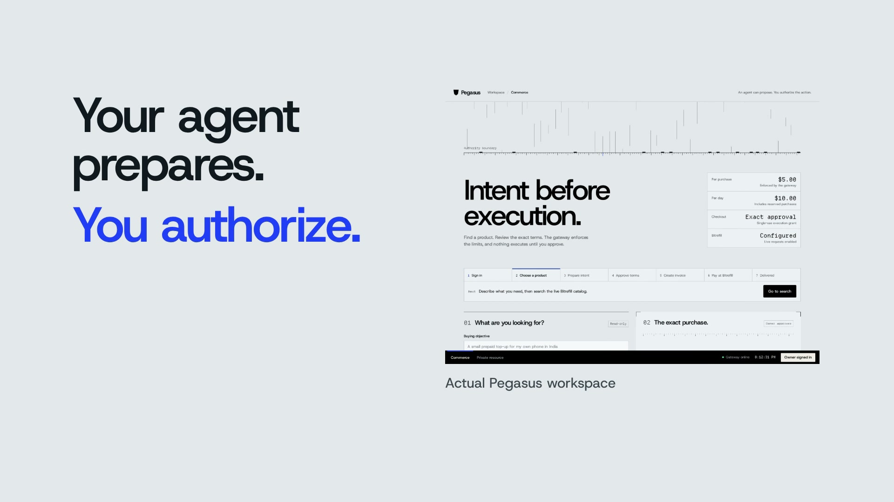

# Pitch and demo video

The revised exported film is **complete and verified**: **120.466667 seconds (2:00.5)**, 1920 × 1080 (16:9), at 30 fps, built with **HyperFrames 0.9.12**. It uses **1.10× narration and footage playback with preserved audio pitch**, plus cleaner brand panel transitions. The original English stock narration asset measures **129.724 seconds**; at the new speed, its timeline playback is **117.931 seconds**, followed by approximately **2.536 seconds** of final hold. Source offsets, payment evidence and disclosures remain intact.

[**Watch or download the final MP4**](assets/pegasus-pitch-demo.mp4) · [Poster](assets/demo-video-poster.jpg) · [Export verification receipt](evidence/demo-video-export.json)

## Verified output

| Property | Measured result |
| --- | --- |
| File | `docs/assets/pegasus-pitch-demo.mp4` |
| Duration / frames | 120.466667 seconds / 3,614 frames |
| Picture | 1920 × 1080, 30 fps, H.264, `yuv420p` |
| Audio | AAC, 48 kHz, stereo |
| Size | 7,744,454 bytes, approximately 7.4 MiB |
| Full audio/video decode | Passed without errors |
| Encoded audio measurement | −14.21 LUFS integrated, −1.54 dBTP true peak |

Twenty-one decoded content frames and twenty transition frames were visually reviewed, including the actual payment proof sequence. Audio levels were measured; no subjective listening test is claimed. The export receipt records the file's SHA-256, exact media metadata and transition details.

## Keep editing locally

Preview: <http://localhost:3004/#project/pegasus-film>

This address works only on the operator's machine while the HyperFrames preview server is running. It is separate from the public application tunnel. The editable project is in the ignored directory `.local/video/pegasus-film/`; its `TIMING.json` supplies the authoritative nine scene boundaries, and `BRIEF.md` and `SPEC.md` record the editorial and evidence constraints.

The preview remains the editable source for future revisions. The review checkpoint and revised export are complete; the verified MP4 is linked above.

## Real source footage and payment

The commerce footage comes from the running dashboard and authenticated catalog flow. Explanatory graphics describe the approval model and explicitly distinguish the two merchant lanes. They are not screenshots of a paid invoice. No Bitrefill purchase or delivered product is claimed; the account's test-product enablement remained pending at the recorded preflight.

The private-resource footage records a fresh API-created order and actual shielded public-testnet payment:

| Field | Observed value |
| --- | --- |
| Transaction | [`5e0179d3ca9ea1be3835a0eadb92ade8244fb4e5f25f8c647c3e74aff0e47929`](https://zexplorer.app/testnet/tx/5e0179d3ca9ea1be3835a0eadb92ade8244fb4e5f25f8c647c3e74aff0e47929) |
| Amount / pool | 100,000 zats (0.001 TAZ), Ironwood |
| Mined height / verification | 4582394, one confirmation |
| Redemption | HTTP 200, resource returned once |
| Repeated redemption | HTTP 409, `NOT_REDEEMABLE` |
| Public receipt | [recorded-demo-checkout.json](evidence/recorded-demo-checkout.json) |

**The payer step is manual.** Noir was not installed. The operator sent from the disposable local payer wallet through the loopback signing service using the amount, address and memo from the API-created order. A separate watch-only receiving database verified the mined note. The same development operator controls both wallets; this is not an independent-customer usability test or a recorded Noir approval popup.

The recording's mining wait was **40.102 seconds**. The approved edit shortens that wait and labels it as condensed, preserving the distinction between a broadcast and the later receiving-wallet confirmation. The HTTP 409 replay result is supported by the recorded API receipt; its graphic is identified as receipt evidence rather than invented browser UI.

## Evidence and privacy limits

The public explorer verifies transaction existence, height and fees. The shielded amount and memo were checked by the merchant's authorized watch-only receiver, not exposed by the explorer. The operator and receiving wallet can associate the order, memo, transaction and resource access; `testnet.zec.rocks` sees wallet synchronization IP and timing.

TAZ settles only the independent Pegasus resource checkout. It does not pay for Bitrefill goods. Earlier receipts remain unchanged and are distinct from the fourth payment recorded for this film.

Footage and published assets must exclude bearer tokens, provider keys, seeds, spending/viewing keys, private checkout links, recipient contact information and redemption codes. The public payment receipt includes no wallet keys or bearer credentials. Voice and music are production assets; they are not evidence of app behavior or payment success.

The source footage, editable composition and preview remain local working artifacts, while the final MP4 and poster live under `docs/assets/`. Their existence does not establish a submitted hackathon entry, separate video hosting or delivered Bitrefill goods.

## Production assets

The edit uses the project's Host Grotesk and Departure Mono fonts, actual dashboard recordings, local GSAP 3.15.0, and HyperFrames 0.9.12. English stock narration and the ambient music asset came through HeyGen; the narration provider received the production script. FFmpeg levels the audio and converts the original recordings to H.264 for browser playback. These source-clip conversions are separate from the final film export.
